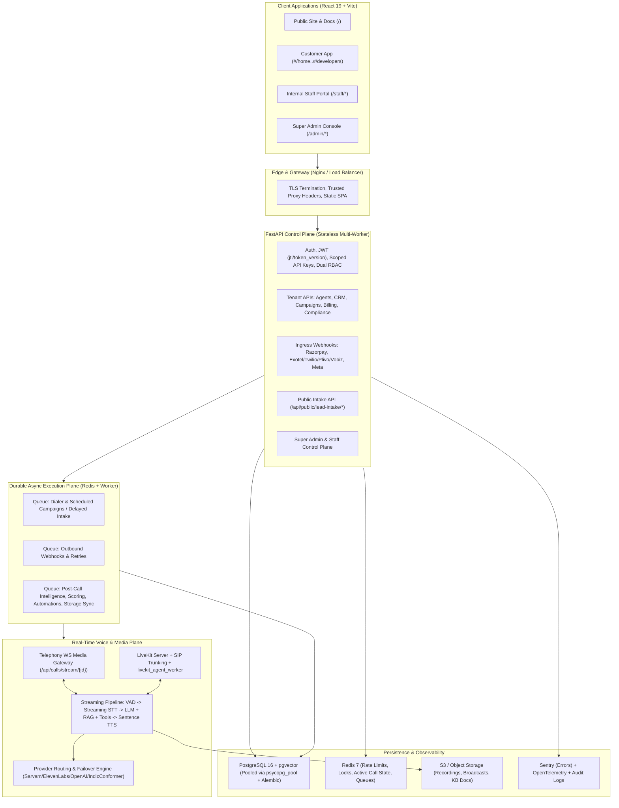

# TRIVAANA AI — Target SaaS & Real-Time Voice Architecture

**Target Version:** 3.0 Production Architecture  
**Stack Foundation:** React 19 + TypeScript + Vite + Tailwind 4 | FastAPI + Pydantic v2 | PostgreSQL 16 + `pgvector` + Alembic | Redis + Celery/ARQ | LiveKit Agents + Telephony WebSocket Media Gateway | S3-Compatible Object Storage.

---

## 1. High-Level Multi-Portal System Architecture

---

## 2. Core Architectural Upgrades Over Current v2.2.0 Codebase

### 2.1 Real-Time Streaming Voice Pipeline (Replacing Synchronous `run_turn`)
* **Current State:** `RealtimeVoicePipeline.run_turn()` (`backend/voice_engine/pipeline.py`) executes blocking STT -> blocking LLM -> blocking TTS sequentially, and `livekit_agent_worker.py` lacks KB RAG, `ActionService`, and DB call persistence.
* **Target Design:**
  1. **Unified Agent Runtime Contract:** Extract an async `AgentTurnOrchestrator` used identically by **LiveKit Agents (`livekit_agent_worker.py`)**, **Telephony WebSocket Media Gateway (`telephony_stream.py`)**, and **Agent Testing Lab (WebRTC / WebSocket)**.
  2. **Streaming Execution:**
     - **VAD & Barge-In:** Silero VAD / LiveKit turn detector cancels active TTS synthesis + clears telephony outbound audio buffer immediately upon caller speech onset (`clear` event).
     - **Streaming STT:** Deepgram / Sarvam Streaming ASR / Whisper chunked streaming with code-mixed (`te-EN`, `hi-EN`, `ta-EN`) Romanized + native script recognition (replacing Unicode-only `detect_language_hint`).
     - **Streaming LLM + Tool Calling:** Async OpenAI streaming yields tokens into a sentence/clause buffer; tool calls (`book_appointment`, `send_whatsapp_template`, `transfer_to_human`, `trigger_opt_out`, `custom_api`) execute via `ActionService` mid-call with spoken filler acknowledgment when latency exceeds `400ms`.
     - **Sentence-Chunked Streaming TTS:** First complete clause triggers Sarvam WS (`bulbul:v4-flash`) or ElevenLabs Flash WebSocket streaming audio directly as G.711 mu-law 8kHz (PSTN) or Opus (WebRTC) frames.
  3. **Live Call State in Redis:** Publish live transcript turns, current agent node, sentiment, and supervisor flags (`listen` / `whisper` / `join` / `hangup`) to Redis Pub/Sub so **Live Call Command Center** streams real-time call state via WebSocket.

### 2.2 Provider Routing, Secrets Vault & Failover Engine
* **Unified `ProviderRegistry`:** Replaces scattered `settings.has_*` checks across `call_service.py`, `voice_adapters.py`, `stt_providers.py`, and `integrations.py`.
* **Encrypted Secrets Store:** Application-level envelope encryption (Fernet / AES-256-GCM via `ENCRYPTION_MASTER_KEY`, KMS-ready) for `provider_configs` (platform-wide) and `integrations.config_json` (tenant BYOK). Admin UI only ever receives masked suffixes (`***abcd`).
* **Smart Failover Policy:** Configurable per language and tier (e.g., Telugu TTS primary = `Sarvam`, fallback = `ElevenLabs` or `OpenAI`; India PSTN primary = `Exotel`, fallback = `Plivo`/`Vobiz`). Circuit breakers in Redis automatically trip on consecutive HTTP `401/402/429/5xx` errors and emit Super Admin alerts.

### 2.3 Durable Queue & Outbox Execution (Fixing Synchronous Request Traps)
* **Campaign & Delayed Intake Dispatch:** `POST /api/campaigns/start` and `POST /api/public/lead-intake/{slug}` (when `delay_seconds > 0`) enqueue durable Redis/Celery tasks (`eta=now + delay_seconds`) instead of blocking HTTP requests or ignoring `delay_seconds`.
* **Distributed Concurrency & Daily Cap Locks:** Redis semaphore per tenant (`concurrency_limit`) and per phone number (`daily_cap`) prevents race conditions across multiple API/worker containers.
* **Webhook & Automation Outbox:** `WebhookService.dispatch_event` writes to `webhook_deliveries` (`status='pending'`) and dispatches asynchronously with exponential backoff (`retry_limit`, `next_retry_at`) in worker processes.

### 2.4 Financial Ledger & Accounting Separation
* **Strict Liability vs. Revenue Distinction:**
  1. **Customer Wallet Top-Up (Razorpay):** Credits `wallet_liabilities` (prepaid customer balance) and generates a **Receipt / Advance Voucher** (or GST invoice aligned to Indian SaaS tax policy — clearly configurable between advance-receipt vs. monthly tax invoice).
  2. **Usage Consumption (Calls, Broadcasts, Monthly Number/Channel Rentals, Subscription Fees):** Debits customer wallet and recognizes **Earned Platform Revenue** (`revenue_entries`), paired with estimated/actual **Provider COGS** (`provider_usage_costs` for STT + LLM + TTS + Telephony) so Super Admin sees true **Gross Margin per Tenant and Plan**.
* **Single Atomic Transaction:** Payment order update (`paid`), wallet credit, transaction insert, and invoice insert commit in a single PostgreSQL `SERIALIZABLE` / `SELECT ... FOR UPDATE` transaction with unified idempotency key `razorpay_order_{order_id}`.

### 2.5 Database Consolidation & PostgreSQL + `pgvector` Parity
* Remove dead `backend/database.py`.
* Adopt **SQLAlchemy / `psycopg_pool` + Alembic** as the single source of truth for migrations across SQLite (local unit tests) and PostgreSQL 16 (staging/production).
* Unify embeddings: Store `vector(1536)` (OpenAI) in `knowledge_chunks_pg` and keep `knowledge_chunks` for fallback local 128-dim tests, or use a dedicated 384-dim open multilingual local embedding model (`bge-small` / `e5-small`) in `speech` microservice when `OPENAI_API_KEY` is absent.

---

## 3. Deployment & Runtime Topology
* **Web / API Service:** FastAPI (`uvicorn`/`gunicorn` with pooled `psycopg_pool` connections, `ENVIRONMENT=production`, strict `ALLOWED_ORIGINS`, `ENCRYPTION_MASTER_KEY`, `JWT_SECRET` >= 32 chars).
* **Worker Service:** Celery/ARQ workers for campaign dialing, scheduled activation, retry sweeps, webhook retries, post-call LLM intelligence, and retention cleanup.
* **Voice Media Worker:** Dedicated `livekit_agent_worker` + WS streaming container scaled horizontally by CPU/concurrent channels.
* **Reverse Proxy:** Nginx strips untrusted `X-Forwarded-For` and passes verified `$remote_addr` in `X-Real-IP`, proxies `/api/`, `/health`, and WebSocket upgrades (`/api/calls/stream/*`, `/api/voice-engine/ws/*`).

